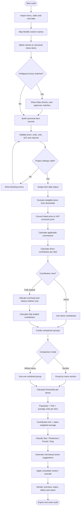
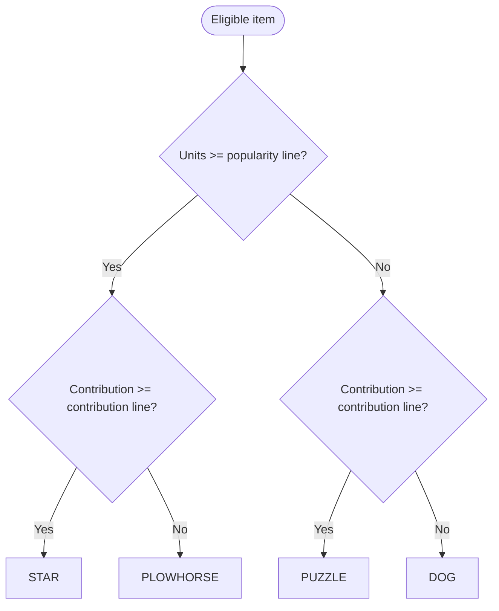
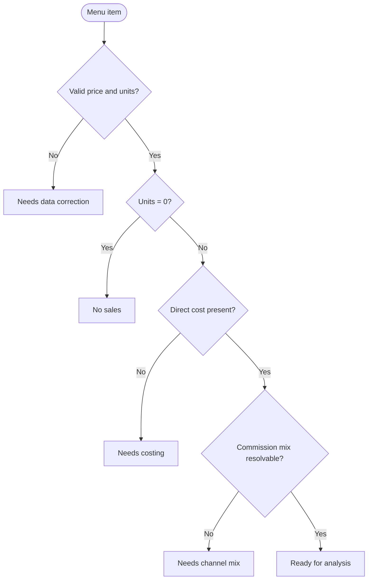

# PIHOCO Menu Engineering — Analysis Algorithm & Logic Specification

**Version:** 1.0  
**Basis:** *PIHOCO Menu X-ray: what was wrong, and what we changed* — internal review dated 12 November 2026.  
**Purpose:** Define the analysis layer used by the paid Audit workspace.

> This document separates rules explicitly stated in the PIHOCO review from implementation choices that need confirmation. It does not silently turn assumptions into PIHOCO policy.

## 1. Analysis pipeline

| Stage | Input | Logic | Output | Rule |
|---|---|---|---|---|
| 1. Import hand-off | Menu, sales, costs CSVs, combined file or X-ray share | Map flexible source columns to canonical fields | Raw item records | Import happens before analysis |
| 2. Identity reconciliation | Imported item names | Exact/fuzzy match to canonical menu item; record every fuzzy match | Reconciled item records | Ambiguous matches require approval; never silently merge |
| 3. Validation | Price, units, direct cost, VAT, channel | Validate presence, type, range and duplicates | Data checks and item status | Missing cost is not zero |
| 4. VAT normalisation | Listed price and VAT setting | If price includes VAT: `netPrice = grossPrice / (1 + VAT rate)` | VAT-exclusive price | Do not subtract a flat percentage of gross |
| 5. Commission | Commission %, channel or delivery share | Calculate commission on applicable sales share | Commission per dish | Do not apply delivery commission to dine-in sales |
| 6. Contribution | Net price, direct cost, commission | `netPrice - directCost - commission` | Direct contribution per dish | Classify per-dish contribution, not total contribution |
| 7. Comparison groups | Section / whole-menu setting | Group eligible items by section or together | Groups | Section-level is default |
| 8. Popularity threshold | Units sold in group | `0.70 × average units per eligible dish` | Popularity line | Kasavana & Smith method stated in review |
| 9. Contribution threshold | Contribution per dish and units | `sum(contribution × units) / sum(units)` | Sales-weighted contribution line | Not a plain unweighted average |
| 10. Classification | Units, contribution, both lines | Apply four-quadrant rules | Star / Plowhorse / Puzzle / Dog | Excluded items remain unclassified |
| 11. Fully loaded view | Direct contribution, indirect cost, overhead | Deduct item indirect cost and allocated overhead per unit | Fully loaded contribution | Separate view; disclose allocation method |
| 12. Action plan | Class, data quality, consultant review | Apply transparent recommendation rules | Prioritised action list | Consultant decision overrides system suggestion |
| 13. Reporting | Results, thresholds, checks and actions | Render overview, matrix, tables, PDF and exports | Audit outputs | Include method and assumptions |

## 2. Required data model

### Canonical item record

| Field | Type | Required? | Meaning |
|---|---|---:|---|
| `id` | string | Recommended | Stable internal item ID |
| `name` | string | Yes | Canonical menu item name |
| `section` | string | Yes | Menu section/category |
| `price` | number | Yes | Current listed menu price |
| `unitsSold` | number | Yes | Units sold in selected reporting period |
| `directCostPerUnit` | number | Yes for classification | Recipe/variable direct cost per dish |
| `netSales` | number | Optional | Period sales value; document VAT basis |
| `channel` | string | Recommended | `delivery`, `dine-in`, `takeaway`, etc. |
| `deliveryShare` | decimal | Conditional | Fraction of item sales through delivery, 0–1 |
| `indirectCostPerUnit` | number | Optional | Item-level indirect cost for fully loaded view |
| `consultantRemark` | string | Optional | Human review note |
| `consultantDecision` | string | Optional | Consultant's approved decision |

### Project settings

| Setting | Example | Purpose |
|---|---:|---|
| VAT rate | `0.05` | VAT-exclusive price calculation |
| Prices include VAT | `true` | Whether VAT must be removed |
| Delivery commission rate | `0.25` | Commission rate as decimal |
| Commission basis | `delivery_only` / `all_sales` | Defines which sales bear commission |
| Comparison mode | `section` / `whole_menu` | Selects comparison population |
| Contribution basis | `direct` / `fully_loaded` | Selects matrix contribution metric |
| Popularity factor | `0.70` | 70% of average units sold |
| Trading days | `30` | Period-to-month scenario scaling |
| Target cost rate | `0.30` | Optional food-cost target |
| Price test rate | `0.03` | Optional test assumption; not an automatic recommendation |
| Period overhead | amount | Overhead pool for fully loaded analysis |
| Overhead allocation basis | sales / units / direct cost / equal | Explicitly selected and disclosed method |

## 3. Formula table

Let `Pg` = gross listed price, `v` = VAT rate, `Pn` = net price, `Cd` = direct cost, `rc` = commission rate, `sd` = delivery share, `Qi` = units sold, and `CMi` = contribution per dish.

| Metric | Formula | Example | Notes |
|---|---|---|---|
| VAT-exclusive price | `Pn = Pg / (1 + v)` when VAT-inclusive; otherwise `Pg` | 105 at 5% VAT → 100 | Correct gross-to-net conversion |
| Commission per dish | `Pn × rc × sd` | 100 × 25% × 60% = 15 | `sd=1` for delivery; `0` for dine-in |
| Direct contribution per dish | `CMi = Pn - Cd - commission` | 100 − 32 − 15 = 53 | Main contribution metric |
| Food-cost rate | `Cd / Pn` | 32 / 100 = 32% | Recipe cost divided by net price |
| Popularity line | `LQ = 0.70 × (sum(Qi) / N)` | Average 100 → line 70 | N = eligible items in group |
| Contribution line | `LCM = sum(CMi × Qi) / sum(Qi)` | Sales-weighted average | Weighted by units sold |
| Fully loaded contribution | `CMFL = CMi - indirectCost - allocatedOverheadPerUnit` | 53 − 4 − 3 = 46 | Optional sensitivity/view |
| Total direct contribution | `sum(CMi × Qi)` | Portfolio total | Useful summary, not classification metric |
| Target price at target food cost | `Cd / targetCostRate` | 32 / 30% = 106.67 net | Diagnostic reference, not automatic price advice |

**Critical distinction:** total contribution is a portfolio metric. The matrix uses contribution **per dish sold** against the weighted contribution threshold.

### 3.1 Fully loaded overhead allocation

The review says overheads can be configured with a sharing method but does not define the approved bases. The implementation can support these configurable methods pending PIHOCO approval:

| Basis | Weight per item | Allocation |
|---|---|---|
| Sales | Item period sales | Pool × item sales / total sales |
| Units | Item units sold | Pool × item units / total units |
| Direct cost | Item direct cost × units | Pool × item direct-cost total / total direct cost |
| Equal | 1 per eligible item | Pool / eligible item count |

Allocated overhead per unit = item overhead allocation / item units sold. State the selected method in the report. Do not mix direct and fully loaded contribution in one matrix.

## 4. Classification logic

| Contribution vs line | Units vs popularity line | Class | Interpretation | Default recommendation |
|---|---|---|---|---|
| At/above | At/above | **Star** | Popular and above contribution benchmark | Protect quality, availability, portion consistency and visibility |
| Below | At/above | **Plowhorse** | Popular but earns less per dish | Review recipe cost, portion, waste, supplier pricing and justified price changes |
| At/above | Below | **Puzzle** | Good contribution but lower demand | Test placement, naming, description, staff recommendation and visibility |
| Below | Below | **Dog** | Below both benchmarks | Assess strategic role; reformulate, reposition, test or consider removal |

Boundary convention: values equal to a threshold are treated as “at or above”. Items with missing cost (`Needs costing`) or no sales (`No sales`) are not classified or counted in thresholds. Invalid price/units and unresolved commission mix are also excluded as safeguards.

## 5. Data validation and matching

| Check | Condition | Status | Engine behaviour |
|---|---|---|---|
| Missing/invalid price | Missing, non-numeric or negative | Needs data correction | Do not calculate or classify |
| Missing/invalid units | Missing, non-numeric or negative | Needs data correction | Do not classify |
| Zero units | Units = 0 | No sales | Exclude from thresholds |
| Missing direct cost | Absent, not zero | Needs costing | Exclude from thresholds |
| Missing indirect cost in fully loaded mode | No item-level indirect cost supplied | Needs indirect costing | Exclude from fully loaded thresholds; explicit zero is allowed only when confirmed |
| Negative direct cost | Cost < 0 | Needs data correction | Exclude |
| Invalid VAT | VAT outside 0–100% | Project-level error | Stop analysis |
| Unknown delivery mix | Commission > 0, delivery-only basis, no channel/share | Needs channel mix | Exclude until resolved |
| Duplicate canonical item | Duplicate after matching | Data check | Reconcile; do not silently add duplicates |
| Fuzzy match | Candidate similarity over configured threshold | Data check | Show original, suggested match and confidence; require approval |
| Missing section | No section | Data check | Mark `Unassigned` visibly |

The review confirms flexible column names and fuzzy matching, with every fuzzy match listed in Data checks. It does not specify the matching algorithm or confidence threshold. Those belong in the import/reconciliation layer, not the contribution engine.

## 6. Flowcharts

### 6.1 End-to-end analysis flow



### 6.2 Classification decision flow



### 6.3 Data eligibility flow



## 7. Action-plan decision table

| Class / condition | Priority | Finding | Suggested action | Measure |
|---|---|---|---|---|
| Data incomplete | P0 | Analysis blocked | Resolve missing cost, sales, price or channel mix before final recommendations | Data completeness and reconciliation |
| Star | P2 | Strong demand and contribution | Protect execution; change only with evidence | Units, contribution/dish, total contribution, availability |
| Plowhorse | P1 | Strong demand, below-benchmark contribution | Review portion, recipe, yield, waste, supplier and justified price | Contribution/dish, food-cost rate, units |
| Puzzle | P2 | Good contribution, low demand | Test placement, description, naming, staff recommendation and visibility | Units, conversion if available, total contribution |
| Dog | P1 | Weak demand and contribution | Assess strategic role; reformulate, reposition, test or consider removal | Units, contribution, waste, prep complexity, feedback |

The action plan is a recommendation queue, not an automatic decision engine. Store consultant decision separately from algorithm classification; retain both for auditability.

## 8. Money-scenario guardrails

| Scenario | Calculation | Required assumption | Display wording |
|---|---|---|---|
| Price test | Price increment × units × period-to-month factor, adjusted for commission | Current sales volume holds | “Illustrative monthly contribution scenario — assumes current volume holds” |
| Cost reduction | Cost reduction/dish × units × period-to-month factor | Saving is achievable without quality/demand loss | Calculate only when quantified saving is entered |
| Puzzle promotion | Incremental units × contribution/dish | User/consultant supplies unit-lift assumption | “Scenario based on entered unit-lift assumption” |
| Dog removal | Avoided waste/complexity less lost contribution and substitution impact | Waste and substitution inputs exist | No money figure without those inputs |

Never invent universal uplift, conversion, elasticity or savings percentages. Label every scenario as an estimate, not a promise.

## 9. JavaScript usage

The accompanying `engine.js` is a framework-independent calculation layer. It expects canonical, reconciled item records; CSV parsing, column mapping, fuzzy-match approval, persistence, PDF rendering and UI integration remain in the workspace application.

```js
const { analyzeMenu } = require('./engine');

const result = analyzeMenu({
  settings: {
    vatRate: 0.05,
    pricesIncludeVat: true,
    commissionRate: 0.25,
    commissionBasis: 'delivery_only',
    comparisonMode: 'section',
    contributionBasis: 'direct',
    popularityFactor: 0.70,
    tradingDays: 30,
    targetCostRate: 0.30,
    priceTestRate: 0.03
  },
  items: [{
    id: 'D001', name: 'Classic Burger', section: 'Mains',
    price: 105, unitsSold: 120, directCostPerUnit: 32,
    channel: 'mixed', deliveryShare: 0.60
  }]
});

console.log(result);
```

Run the smoke test with `node engine.smoke.test.js`.

## 10. Workspace integration contract

| Screen | Engine output | UI behaviour |
|---|---|---|
| Data checks | `items[].status`, `items[].issues` | Show unresolved issues and imported source names |
| Overview | `summary` | Headline counts/totals; show period and currency |
| Matrix | `items[].classification`, `items[].thresholds` | Plot each item against actual group thresholds |
| All sections matrix | Each item's own thresholds | Do not apply one global line to every section |
| Performance table | Item metrics | Sort/filter; retain raw precision internally |
| Action plan | `actionPlan[]` | Show priority, finding, why, step, measure, owner, timing and scenario note |
| Consultant review | `consultantRemark`, `consultantDecision` | Display override wherever recommendation appears |
| PDF | Methodology, thresholds, items, action plan | Include assumptions, exclusions, period and method |
| CSV export | Item metrics and actions | Export numeric values, not formatted strings |
| Backup/restore | Inputs, settings and review | Re-run engine after restore; calculated output is not source of truth |

## 11. Decisions to confirm before production

1. **Commission base:** the code below uses VAT-exclusive menu price × commission rate × delivery share. Confirm whether the contractual commission is instead based on actual delivery-channel net sales or another base.
2. **Mixed-channel share:** supply delivery share per item or channel-specific units/sales. If commission applies but mix is unknown, the engine marks `Needs channel mix` instead of assuming zero.
3. **Indirect costs:** confirm which costs are included and how they are measured.
4. **Overhead allocation:** the review says overheads can be shared but does not define approved bases. The code supports sales, units, direct cost and equal allocation as configurable options pending approval.
5. **Contribution weighting:** code weights by units sold, consistent with “average contribution per dish, weighted by sales”. If PIHOCO intends weighting by sales value, that is a different method.
6. **POS net sales:** document VAT/discount treatment. The code uses `netSales` for overhead allocation only; contribution uses menu price as described in the review.
7. **Price scenarios:** sample scenario assumes unchanged volume after a price test; it is explicitly labelled and does not predict elasticity.
8. **Consultant override:** store final consultant decision separately; do not erase original algorithm classification.
9. **Currency and rounding:** retain full precision internally; round only for display/export formatting.

## 12. Acceptance tests

| Test | Input | Expected |
|---|---|---|
| VAT removal | Gross 105, VAT 5% | Net = 100 |
| Commission | Net 100, commission 20%, delivery share 50% | Commission/dish = 10 |
| Contribution | Net 100, cost 30, commission 10 | Contribution/dish = 60 |
| Popularity | Units 100, 80, 60 | Average 80; line 56 |
| Weighted contribution | CM 60, 40, 20; units 100, 50, 50 | Line = 45 |
| Star | Both metrics at/above lines | Star |
| Plowhorse | Units at/above; contribution below | Plowhorse |
| Puzzle | Units below; contribution at/above | Puzzle |
| Dog | Both below | Dog |
| Missing cost | Direct cost absent | Needs costing; excluded |
| Missing indirect cost | Fully loaded mode, indirect cost absent | Needs indirect costing; excluded from fully loaded thresholds |
| Zero sales | Units = 0 | No sales; excluded |
| Unknown delivery mix | Commission > 0, delivery-only, no channel/share | Needs channel mix; excluded |
| Section mode | Items in multiple sections | Separate thresholds |
| Whole-menu mode | All items together | One shared threshold pair |
| Fully loaded | Direct less indirect and overhead/unit | Matrix uses fully loaded contribution and weighted line |

## 13. Non-negotiable architecture rule

**One source of truth:** calculate every metric once in the engine. Overview, matrix, performance table, action plan, PDF and CSV exports must consume the same result object. No screen should independently reimplement the formulas.
